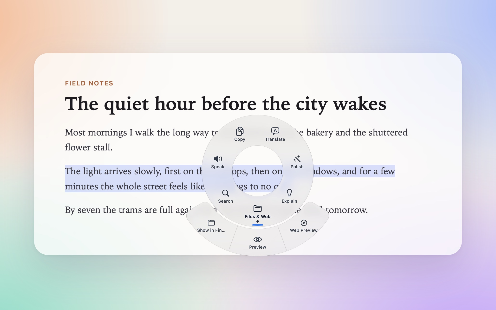
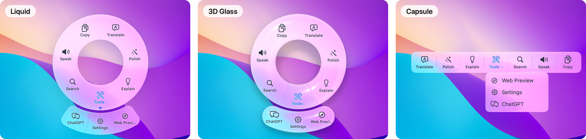

<h1 align="center">
  <br/>
  QDuo
</h1>

<p align="center">
  Select text in any Mac app, and your own actions appear right at the cursor — translate, polish, search, speak, transform, or ask a model, and put the result straight back.
</p>

<p align="center">
  <a href="README.md">中文</a> · <b>English</b>
</p>

<p align="center">
  <a href="https://github.com/XueshiQiao/qduo/releases/latest">Download</a> ·
  <a href="https://xueshi.dev">More apps I made</a>
</p>

<p align="center">
  <a href="https://github.com/XueshiQiao/qduo/releases/latest"></a>
  
  <a href="LICENSE"></a>
</p>



## What you can do with it

- **A paragraph on a foreign web page you can't read: select it and click Translate.** The translation streams in next to the cursor. The built-in Translate turns Chinese into English and anything else into Simplified Chinese, and keeps every line break and blank line where it was.

- **A reply you've written that could read better: select it and click Polish.** The popup shows your text above the result, with removed words in red and added words in green. Once you've checked it, click the replace button (two arrows in a circle) and the result goes back into the text field. The built-in Polish works this way on new installs.

- **No API key, and you still want a translation: use System Translate.** It uses macOS's own translator — no model, no API key. Needs macOS 15 or later. There are three cases:
  - Both languages are already downloaded on this Mac: it translates on your Mac, works offline, and the text never leaves your Mac.
  - Not downloaded yet, but you've added the "Translate without downloading" Shortcut in the action's editor: the text goes to that Shortcut and Apple's translation servers translate it, so it needs an internet connection.
  - Not downloaded yet and no Shortcut: macOS shows its window for downloading languages, and the translation appears once the download finishes. Downloading needs a connection; after that, translating between those two languages happens on your Mac.

- **A word you don't know, or an error message: select it and click Search.** Search uses Google by default. The templates also have Baidu, Bing, Wikipedia, GitHub, the system dictionary, Maps, and asking ChatGPT or Claude with the selection as the question. When the selection is itself a web address, an Open URL action whose address is just `{text}` opens it.

- **A long article you'd rather listen to: select it and click Speak.** The popup shows the whole text and highlights each word as it's read; you can pause or start over. It uses the macOS system voice by default, which stays on your Mac, or voices from Qwen-Audio (Alibaba), MiniMax or ElevenLabs, set up in Settings → Speech.

- **Text pasted from a PDF with a break on every line, a variable name to turn into snake_case, a blob of JSON to tidy: use a Transform Text action.** 22 operations, all done on your Mac. Word count shows its result in the popup; every other operation replaces the selection with its result. They include: join PDF line breaks, change case, camelCase / snake_case, sort or dedupe lines, Simplified ↔ Traditional Chinese, pinyin, spacing between CJK and Latin, format or minify JSON, URL encode and decode, strip link tracking, word count.

- **Text in an image or a video frame you can't select: press <kbd>⌘</kbd> <kbd>⇧</kbd> <kbd>S</kbd> and drag a box over it.** QDuo recognises the text on your Mac, and it comes up in the same popup with all your actions. Change the shortcut in Settings → Screenshot Text.

- **Text selected inside tmux (with mouse mode) or vim in a terminal: as long as the program copies the selection to the system clipboard, QDuo opens the popup with that text.** tmux and vim have to be set up to copy selections to the system clipboard. Works in Ghostty, Terminal, iTerm2, OTTY, WezTerm, kitty, Alacritty and Warp; add or remove terminals in Settings → Advanced → Terminals.

- **A translation from last week you want back: open Settings → History.** Every action you run from the popup is kept on this Mac: the text you selected, the result, which app and which model. Browse by day, search in Chinese or English, filter by kind or by app, and replay a read-aloud with the same word-by-word highlighting.

- **Your own workflow: use a Run Shortcut or Run Script action.** The selection becomes the Shortcut's input, or goes to a shell command on standard input; whatever comes out is the result. QDuo asks before a script runs for the first time, and again whenever you change it.

- **You'd rather the popup didn't appear on every selection: turn on "Open with a shortcut" in Settings → Advanced.** Then the popup appears only when you select text and press the shortcut.

A new install starts with these actions in the popup: Translate, Polish, Explain, Search, Speak, Copy, and a Tools group holding Web Preview, Settings and ChatGPT. System Translate, Transform Text, Run Shortcut and Run Script, mentioned above, are added from Settings → Actions → Add from Template.

An AI action is a prompt you write. Translate, Polish and Explain come built in; Settings → Actions → Add from Template has Summarize, Fix Grammar, Change Tone, Break Down Sentence and Explain Code. Each action can use its own model.

## What the popup looks like



Choose in Settings → General → Display style:

- **Liquid** — a ring around the cursor.
- **3D Glass** — a glass ring with real depth that leans gently toward the pointer.
- **Capsule** — a bar above the selection.

Put several actions in a **group**: it unfolds into a second ring on a ring, and into a dropdown on the capsule. An action's icon can be any SF Symbol, found by name, or a PNG of your own.

## Where the result goes

Set it per action:

| Setting | What happens |
| --- | --- |
| Show in the popup | Shown at the cursor, where you can copy it or click the replace button to write it back |
| Compare, then replace | The popup marks what changed; you replace once you've checked it |
| Replace the selection | Written straight back in place |
| Insert after the selection | Written after the selected text |
| Copy to the clipboard | Put on the clipboard |

QDuo only writes back when it can confirm the selection is still where you left it. If you've switched apps or the selection has changed, it writes nothing, copies the result to the clipboard instead, and tells you why.

## Install

### Homebrew

```bash
brew install --cask XueshiQiao/tap/qduo
```

<details>
<summary>Prefer the two-step form?</summary>

```bash
brew tap XueshiQiao/tap
brew trust XueshiQiao/tap   # Homebrew 6.0+; earlier versions can skip this line
brew install --cask qduo
```

Since Homebrew 6.0 a cask from a third-party tap will not load unless the tap is
trusted — or the cask is named in full on the command line, which is exactly what
the one-liner above does.
</details>

### Direct download

Download `QDuo.dmg` from [GitHub Releases](https://github.com/XueshiQiao/qduo/releases) and drag QDuo into your Applications folder. The app is signed with an Apple Developer ID certificate and notarized by Apple, so it installs without any security warnings.

### First launch

1. Open QDuo. It lives in the menu bar, with no Dock icon.
2. Grant Accessibility when the guide asks.
3. For AI actions, pick a provider in Settings → AI Models and paste an API key. DeepSeek, OpenAI, Doubao (Ark), Qwen (DashScope) and Ollama are built in; change the Base URL to use any OpenAI-compatible service. Ollama runs on your Mac and needs no key.
4. Select text anywhere, and the popup appears at the cursor.

### Permissions

| Permission | With it | Without it |
| --- | --- | --- |
| Accessibility (required) | Reads the selected text, notices when you select something, and writes results back | The popup does not appear |
| Screen Recording (optional) | <kbd>⌘</kbd> <kbd>⇧</kbd> <kbd>S</kbd> screenshot text works. QDuo has to be reopened after you grant it | Screenshot text is unavailable; nothing else is affected |

Both are in System Settings → Privacy & Security.

QDuo is not sandboxed: reading another app's selection and watching the mouse globally are both impossible inside the App Sandbox.

## Privacy

- API keys live only in the macOS Keychain, never in the settings file.
- Your selection leaves this Mac only after you click an action, and only goes where that action needs it: an AI action sends it to the model provider you chose; a cloud voice sends it to that voice's provider; Open URL and Search put it in an address for that website; System Translate through the Shortcut sends it to Apple's translation servers. The system voice, on-device System Translate and Transform Text all stay on this Mac.
- Screenshot text is recognised on your Mac, and screenshots are not saved.
- History stays on this Mac: it is not uploaded or written to the log. The gear on the History page turns recording off, sets how long records are kept (forever by default), clears everything, and lists apps that are never recorded (common password managers to start with).
- Anonymous usage stats can be turned off in Settings → About. They never include selected text, process names, paths or personal data.

## More

### One readable settings file

Everything is in `~/.config/qduo/config.json`, with a JSON Schema beside it so editors can complete fields and flag mistakes. Keep it in your dotfiles; API keys are not in it.

### Run an action from other apps

Alfred, Raycast and other tools can open `qduo://run/<action name>?text=<text>` to have QDuo run an action on that text. For safety this is off for every action; turn it on at the bottom of an action's editor ("Allow other apps to run this action from a URL"), which also shows the URL to use.

### Action types

| Type | What it does |
| --- | --- |
| **AI prompt** | Sends the selection and your prompt to a model |
| **System Translate** | Translates on your Mac with macOS's own translator |
| **Open URL** | Fills `{text}` into an address and opens it, in the browser or in the popup's preview window |
| **Speak** | Reads the selection aloud, highlighting each word |
| **Transform Text** | 22 local text operations |
| **Run Shortcut** | Hands the selection to one of your Shortcuts |
| **Run Shell Script** | Pipes the selection through a shell command; asks before the first run and after every change |
| **Web Preview** | Previews a link in the selection inside the popup |
| **Copy** | Copies the selection to the clipboard |
| **Preview a file (Quick Look)** | When the selection is a path to a file on this Mac, previews it with Quick Look |
| **Show in Finder** | When the selection is a path to a file or folder, shows it in Finder |
| **Group** | Holds several actions; a group can also be given a type, which runs when you click it |
| **Pause / Open settings** | Pauses QDuo, or opens the settings window, from the popup |
| **Inspect element (debug)** | Shows the interface element holding the selection, for writing ignore rules |

Most types have ready-made examples in Settings → Actions → Add from Template; Copy and Web Preview are already in the popup on a new install.

### Updates

QDuo checks for and installs updates with [Sparkle](https://sparkle-project.org).

### Uninstall

Quit QDuo and move it from Applications to the Trash. To remove every trace, also delete:

- Settings file: `~/.config/qduo/`
- History: `~/Library/Application Support/me.xueshi.qduo/`
- Logs: `~/Library/Logs/QDuo/`
- Speech cache: `~/Library/Caches/QDuo/`
- Preferences: `~/Library/Preferences/me.xueshi.qduo.plist`
- A folder left by older versions: `~/Library/Application Support/QDuo/` (only if you upgraded from one)
- The `qduo-translate` Shortcut in the Shortcuts app (only if you added it for System Translate)

API keys live in the Keychain. Before uninstalling, click Clear for each provider in Settings → AI Models and Settings → Speech to delete them.

## Build from Source

See [DEVELOPMENT.md](DEVELOPMENT.md).

## License

GPL v3.0 — see [LICENSE](LICENSE).

---

If QDuo saves you a few trips to the clipboard, please [star the repo](https://github.com/XueshiQiao/qduo) — it helps others find it.
