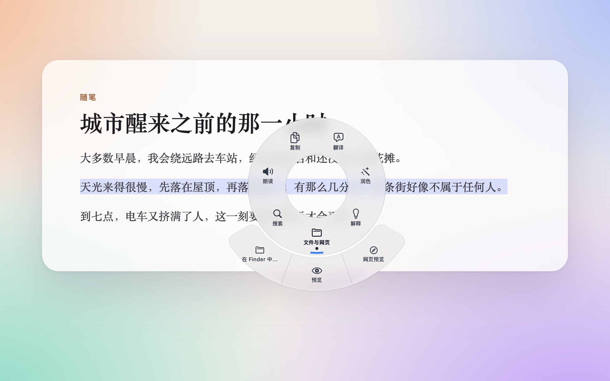
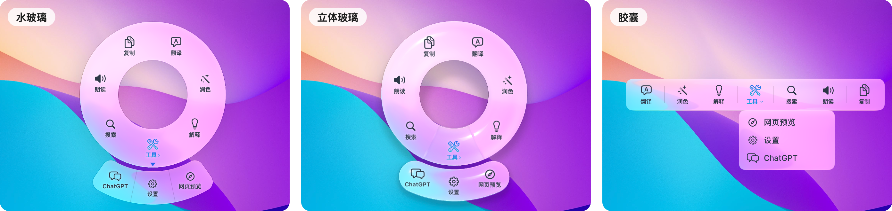

<h1 align="center">
  <br/>
  QDuo
</h1>

<p align="center">
  在 Mac 的任何 app 里选中文字，光标旁就出现你自己设置的动作：翻译、润色、搜索、朗读、处理文本、问大模型，结果还能直接放回原处。
</p>

<p align="center">
  <b>中文</b> · <a href="README.en.md">English</a>
</p>

<p align="center">
  <a href="https://github.com/XueshiQiao/qduo/releases/latest">下载</a> ·
  <a href="https://xueshi.dev">我做的其他 app</a>
</p>

<p align="center">
  <a href="https://github.com/XueshiQiao/qduo/releases/latest"></a>
  
  <a href="LICENSE"></a>
</p>



## 能用它做什么

- **读外文网页，有一段看不懂：选中它，点「翻译」。** 译文边生成边显示在光标旁。默认的翻译动作把中文译成英文，把其他语言译成简体中文，原文的换行和空行都保留在原来的位置。

- **写完一段英文回复，想改得更通顺：选中它，点「润色」。** 弹窗里上面是你写的原文，下面是改好的文字，删掉的字标红，加上的字标绿。你看过觉得可以，再点替换按钮（两个箭头绕成一圈的图标），改好的文字就写回原来的输入框。新安装时，内置的「润色」动作就是这样设置的。

- **没有 API Key，也想翻译：用「系统翻译」。** 它用 macOS 自带的翻译功能，不需要大模型，也不需要 API Key，需要 macOS 15 或更新版本。翻译时分三种情况：
  - 原文的语言和要译成的语言都已经下载到这台 Mac 上：直接在本机翻译，断网也能用，文字不会离开这台 Mac。
  - 还没下载，但你在动作的编辑页添加过「不下载语言也能翻译」的快捷指令：文字交给这个快捷指令，由 Apple 的翻译服务器翻译，这时需要联网。
  - 还没下载，也没有添加快捷指令：macOS 弹出下载语言的窗口，下载完成后译文自动出现。下载需要联网；下载完之后，这两种语言之间的翻译都在本机完成。

- **看到一个不认识的词或者一行报错：选中它，点「搜索」。** 默认用 Google 搜索。模板里还有百度、Bing、维基百科、GitHub、系统词典、地图，以及把选中的文字直接交给 ChatGPT 或 Claude 提问。选中的是一个网址时，把动作的网址只写成 `{text}`，点一下就打开这个网址。

- **一篇长文想听一遍：选中它，点「朗读」。** 弹窗显示全文，读到哪个字，哪个字就高亮，可以暂停、从头再读。默认用 macOS 的系统语音，只在本机处理；也可以在「设置 → 朗读」里接入 Qwen-Audio（阿里云）、MiniMax 或 ElevenLabs 的声音。

- **从 PDF 复制出来的文字每行都断开，或者要把变量名改成 snake_case、把一段 JSON 排好版：用「文本处理」动作。** 一共 22 种操作，全部在本机完成。除了统计字数会把结果显示在弹窗里，其他操作的结果都直接替换选中的文字。其中有：合并断行、改大小写、camelCase / snake_case、按行排序或去重、繁简转换、加拼音、在中英文之间加空格、格式化或压缩 JSON、URL 编码和解码、去掉链接里的跟踪参数、统计字数。

- **图片或者视频画面里的字选不中：按 <kbd>⌘</kbd> <kbd>⇧</kbd> <kbd>S</kbd>，框出那一块。** QDuo 在本机识别出文字，识别结果出现在同一个弹窗里，所有动作照常可以用。快捷键可以在「设置 → 截屏取字」里改。

- **在终端里用 tmux（开了鼠标模式）或 vim 选中了一段文字：只要这个程序把选中的文字复制到了系统剪贴板，QDuo 就用剪贴板里的这段文字弹出动作。** tmux 和 vim 要设置成选中时复制到系统剪贴板才行。支持 Ghostty、Terminal、iTerm2、OTTY、WezTerm、kitty、Alacritty 和 Warp，名单在「设置 → 高级 → 终端」里增减。

- **想找回上周翻译过的一段话：打开「设置 → 历史」。** 每次从弹窗运行的动作都记在这台 Mac 上：选中的文字、结果、在哪个 app 里、用的哪个模型。可以按天浏览，用中文或英文搜索，按类型或 app 筛选，朗读过的内容还能带着逐字高亮再听一遍。

- **想把选中的文字交给自己的流程：用「运行快捷指令」或「运行脚本」动作。** 选中的文字作为快捷指令的输入，或者从标准输入交给一条 Shell 命令；它们输出的内容就是结果。脚本第一次运行之前，以及每次改动脚本之后，QDuo 都会先问你。

- **不想每次选中文字都弹出来：在「设置 → 高级」里打开「用快捷键弹出」。** 打开后，只有选中文字再按快捷键，弹窗才会出现。

新安装时，弹窗里已经有这些动作：翻译、润色、解释、搜索、朗读、复制，还有一个「工具」分组，里面是网页预览、设置和 ChatGPT。上面提到的系统翻译、文本处理、运行快捷指令、运行脚本，要在「设置 → 动作 → 从模板添加」里自己加。

AI 动作就是你写的一段提示词。默认带「翻译」「润色」「解释」三个；「设置 → 动作 → 从模板添加」里还有总结、语法纠错、改语气、句子解析、解释代码。每个动作可以单独选用哪个模型。

## 弹窗长什么样



在「设置 → 通用 → 显示样式」里选：

- **水玻璃**：围着光标的一圈圆环。
- **立体玻璃**：有厚度的玻璃圆环，会朝鼠标的方向微微倾斜。
- **胶囊**：选中文字上方的一条横条。

几个动作可以放进一个**分组**，在圆环上展开成第二圈，在胶囊条上展开成下拉菜单。动作的图标可以从 SF Symbols 里搜，也可以用你自己的 PNG 图片。

## 结果放到哪里

每个动作可以单独设置结果去哪里：

| 设置 | 结果会怎样 |
| --- | --- |
| 显示在弹窗里 | 在光标旁显示，可以复制，也可以点替换按钮写回原处 |
| 先对比，再替换 | 弹窗里标出改了哪些字，你确认后再替换 |
| 替换选中的文字 | 直接写回原处 |
| 插入到选中文字后面 | 写在选中的文字后面 |
| 复制到剪贴板 | 放进剪贴板 |

只有确认选中的文字还在原来的位置时，QDuo 才会写回去。如果你已经切换了 app，或者选中的内容变了，QDuo 不会写入，而是把结果复制到剪贴板，并告诉你原因。

## 安装

### Homebrew

```bash
brew install --cask XueshiQiao/tap/qduo
```

<details>
<summary>想分两步装？</summary>

```bash
brew tap XueshiQiao/tap
brew trust XueshiQiao/tap   # Homebrew 6.0 及以上需要这一步，更早的版本可以跳过
brew install --cask qduo
```

从 Homebrew 6.0 开始，第三方 tap 里的 cask 必须先被信任才能加载，或者像上面那条一行命令那样写全名。
</details>

### 直接下载

从 [GitHub Releases](https://github.com/XueshiQiao/qduo/releases) 下载 `QDuo.dmg`，把 QDuo 拖进「应用程序」文件夹。App 用 Apple Developer ID 证书签名，并经过苹果公证，安装时不会有安全警告。

### 第一次打开

1. 打开 QDuo。它只在菜单栏显示图标，不占用 Dock。
2. 按引导授予「辅助功能」权限。
3. 要用 AI 动作，在「设置 → AI 模型」里选一个服务商，填上 API Key。内置 DeepSeek、OpenAI、Doubao (Ark)（豆包）、Qwen (DashScope)（通义千问）和 Ollama；改 Base URL 可以接任何兼容 OpenAI 接口的服务。Ollama 在本机运行，不需要 API Key。
4. 在任何地方选中文字，光标旁就会弹出动作。

### 权限

| 权限 | 开启后 | 不开启时 |
| --- | --- | --- |
| 辅助功能（必需） | 读取选中的文字，知道你什么时候选中了东西，把结果写回原处 | 选中文字时不会弹出 |
| 屏幕录制（可选） | 可以按 <kbd>⌘</kbd> <kbd>⇧</kbd> <kbd>S</kbd> 截屏取字。授权之后要重新打开 QDuo 才生效 | 截屏取字不能用，其他功能不受影响 |

两个权限都在「系统设置 → 隐私与安全性」里。

QDuo 没有启用沙盒：读取别的 app 里选中的文字、在全局监听鼠标，这两件事在 App 沙盒里都做不到。

## 隐私

- API Key 只存在 macOS 的钥匙串里，不写进设置文件。
- 选中的文字只在你点了某个动作之后才会离开这台 Mac，而且只发给这个动作要用的地方：AI 动作发给你选的模型服务商；用云端声音朗读时发给对应的朗读服务商；打开网址和搜索会把文字放进网址交给那个网站；系统翻译走快捷指令时发给 Apple 的翻译服务器。系统语音朗读、本机的系统翻译和文本处理都只在这台 Mac 上完成。
- 截屏取字在本机识别，截图不保存。
- 历史记录只存在这台 Mac 上，不上传，也不写进日志。在「设置 → 历史」页面的齿轮按钮里，可以关掉记录、设置保留多久（默认一直保留）、清空全部记录，还可以列出不记录的 app（默认已经包含常见的密码管理器）。
- 匿名使用统计可以在「设置 → 关于」里关掉。统计里从不包含选中的文字、进程名、文件路径或任何个人信息。

## 更多

### 一个看得懂的设置文件

所有设置都在 `~/.config/qduo/config.json`，旁边附带一份 JSON Schema，编辑器可以据此自动补全、提示写错的地方。这个文件可以放进你的 dotfiles 仓库，API Key 不在里面。

### 从别的 app 运行动作

Alfred、Raycast 等工具可以打开 `qduo://run/<动作名>?text=<文字>` 这样的网址，让 QDuo 对这段文字运行某个动作。为了安全，每个动作默认都不允许这样运行；要用的话，在动作编辑页底部打开「允许其他 app 通过 URL 运行此动作」，那里也会显示要用的网址。

### 动作类型一览

| 类型 | 做什么 |
| --- | --- |
| **AI 提示词** | 把选中的文字和你写的提示词发给大模型 |
| **系统翻译** | 用 macOS 自带的翻译在本机翻译 |
| **打开网址** | 把 `{text}` 换成选中的文字，打开这个网址；网页可以在浏览器里打开，也可以在弹窗的预览窗口里打开 |
| **朗读** | 把选中的文字读出来，读到哪个字高亮哪个字 |
| **文本处理** | 22 种本地文本操作 |
| **运行快捷指令** | 把选中的文字交给你的某个快捷指令 |
| **运行 Shell 脚本** | 把选中的文字交给一条 Shell 命令；第一次运行前和每次改动后都会先问你 |
| **网页预览** | 选中的文字里有链接时，在弹窗里预览这个网页 |
| **复制** | 把选中的文字复制到剪贴板 |
| **预览文件（快速查看）** | 选中的文字是这台 Mac 上的文件路径时，用快速查看预览这个文件 |
| **在 Finder 中显示** | 选中的文字是文件或文件夹的路径时，在 Finder 里显示它 |
| **分组** | 把几个动作装在一起；分组本身也可以设成某个类型，点它时运行 |
| **暂停 / 打开设置** | 在弹窗里暂停 QDuo，或者打开设置窗口 |
| **检查元素（调试）** | 显示选中的文字所在的界面元素，写排除规则时用 |

大部分类型在「设置 → 动作 → 从模板添加」里有现成的例子；复制和网页预览新安装时已经在弹窗里了。

### 更新

QDuo 通过 [Sparkle](https://sparkle-project.org) 检查和安装更新。

### 卸载

退出 QDuo，把「应用程序」里的 QDuo 移到废纸篓。想清掉全部痕迹，再删除下面这些：

- 设置文件：`~/.config/qduo/`
- 历史记录：`~/Library/Application Support/me.xueshi.qduo/`
- 日志：`~/Library/Logs/QDuo/`
- 朗读缓存：`~/Library/Caches/QDuo/`
- 偏好设置：`~/Library/Preferences/me.xueshi.qduo.plist`
- 旧版本留下的文件夹：`~/Library/Application Support/QDuo/`（从旧版本升级上来的才有）
- 「快捷指令」app 里的 `qduo-translate` 快捷指令（给系统翻译添加过才有）

API Key 存在钥匙串里。卸载之前，先在「设置 → AI 模型」和「设置 → 朗读」里点「清除」，把每个服务商的密钥删掉。

## 从源码构建

见 [DEVELOPMENT.md](DEVELOPMENT.md)。

## 许可证

GPL v3.0，见 [LICENSE](LICENSE)。

---

如果 QDuo 帮你少复制粘贴了几次，欢迎[点个 Star](https://github.com/XueshiQiao/qduo)，能让更多人发现它。
